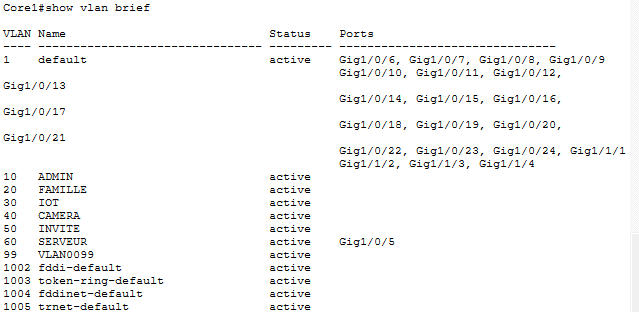
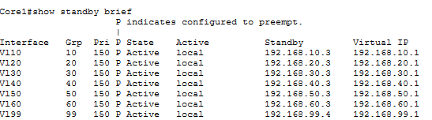
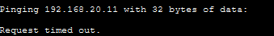
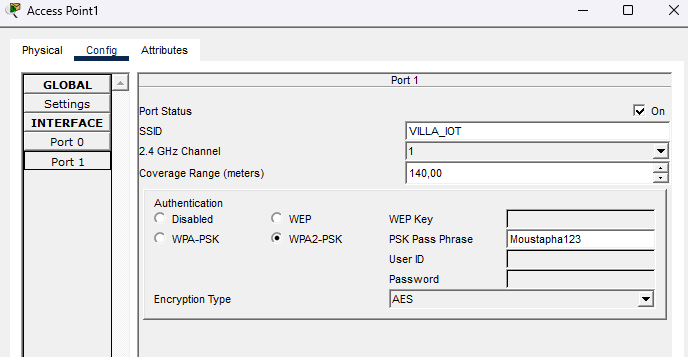

# Smart Villa IoT – Simulation de réseau domestique et mobile

Architecture réseau d'entreprise simulée sous Cisco Packet Tracer pour une maison intelligente : segmentation VLAN, haute disponibilité, sécurité, intégration d'objets IoT et automatisation domotique.

## Objectifs

- Segmentation VLAN (7 VLAN) et routage inter-VLAN
- Haute disponibilité : HSRP, EtherChannel/LACP, Rapid PVST+
- Sécurité : ACL, SSH, Wi-Fi WPA2-PSK (deux points d'accès dédiés IoT/caméras)
- Services réseau : DHCP, DNS
- Automatisation domotique via serveur IoT (règles conditionnelles)

## Architecture

Modèle hiérarchique à deux niveaux (Core/Access), avec deux switches de cœur redondants pour éliminer tout point de défaillance unique.

## Segmentation réseau

Sept VLAN pour isoler les usages : administration, famille, IoT, caméras, invités, serveurs, et management natif.

## Haute disponibilité

HSRP assure le basculement automatique entre les deux switches de cœur en cas de panne, sans interruption perceptible pour l'utilisateur.

## Sécurité

Des listes de contrôle d'accès (ACL) filtrent le trafic entre VLAN selon le principe du moindre privilège, et l'administration est sécurisée par SSH.

## Connectivité Wi-Fi

Deux points d'accès sécurisés en WPA2-PSK/AES, un dédié au VLAN IoT, l'autre au VLAN caméras, pour préserver l'isolation logique jusqu'au Wi-Fi.

## Automatisation domotique

Le serveur IoT applique des règles conditionnelles en temps réel :

- Détecteur de mouvement → activation automatique de la caméra
- Régulation thermique à trois zones : température basse → ventilateur, zone de confort → systèmes éteints, température haute → climatisation

## Tests réalisés

- Basculement HSRP en cas de panne du routeur actif
- Filtrage ACL entre VLAN
- Connexion Wi-Fi sécurisée des objets IoT
- Déclenchement automatique des règles domotiques

## Fichiers

- `smart-villa.pkt` — fichier Packet Tracer

## Compétences démontrées

VLAN, routage inter-VLAN, HSRP, EtherChannel, STP, ACL, DHCP, DNS, SSH, sécurité Wi-Fi, automatisation IoT

## Auteur

Mamadou Moustapha Talla
